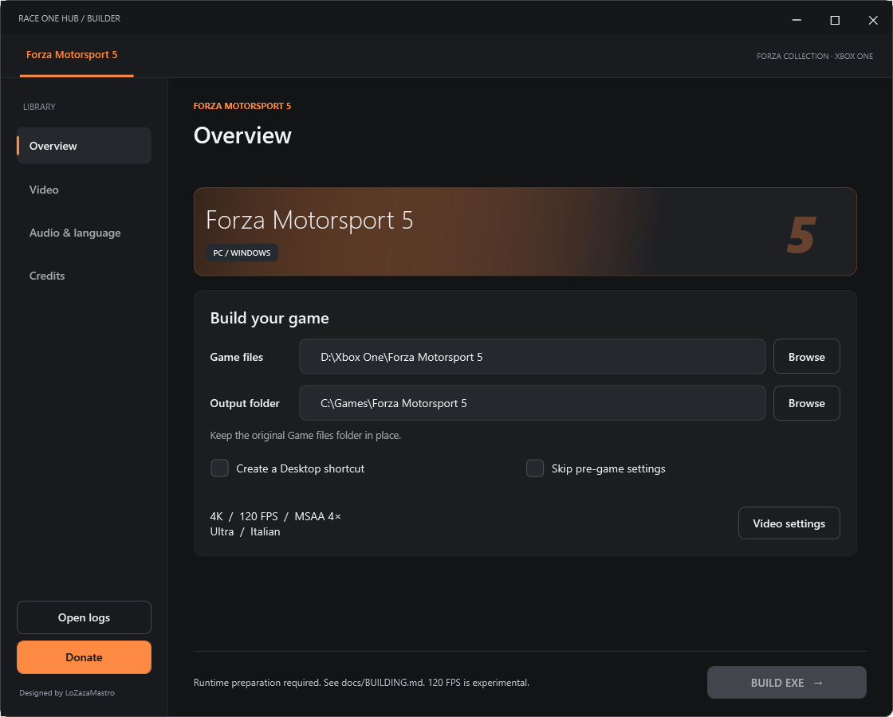
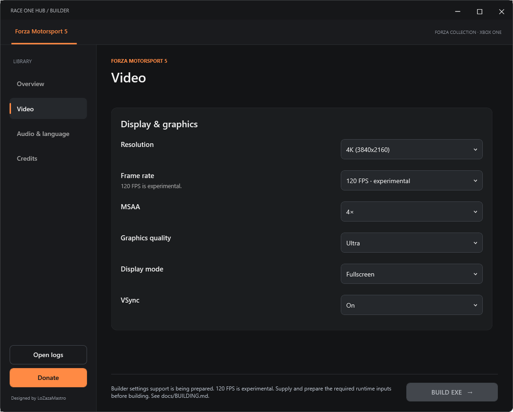

# Race One Hub

A Windows PC builder and compatibility-adapter project for **Forza Motorsport 5**.

[Download RaceOneHub.exe](https://github.com/LoZazaMastro/RaceOneHub/releases/latest/download/RaceOneHub.exe)

Choose your extracted game folder, graphics, audio and language settings. The builder generates `RaceOne5.exe` and its supporting files. Your original game stays in its own folder and is not modified. The optional pre-game settings screen uses the same native window and process as the game.

`RaceOneHub.exe` is a single-file Windows app. It contains the engine and support components and extracts them automatically to a local cache when opened. You do not need to install Python, .NET or Visual Studio, or download a separate runtime.

The actual game files are not included or downloaded. You supply your own extracted FM5 folder; the pre-game background is the only included game artwork. Generated game folders are private local outputs and must not be published as the builder download.

The preview uses example folder paths. No game content appears in the image.

## How to play

You need Windows 10/11 x64 and your own complete, extracted Xbox One copy of Forza Motorsport 5, version **1.0.0.20**. Open the single `RaceOneHub.exe`; its supporting components are unpacked automatically under `%LOCALAPPDATA%\RaceOneHub\components`.

1. Open `RaceOneHub.exe` and select the game folder containing `Mount` and `EmbeddedXvd`.
2. Choose an output location. The builder creates a **Forza Motorsport 5** folder there for the executable and its supporting files.
3. Choose your video, audio and language settings. Leave **Skip pre-game settings** unchecked if you want to adjust them before each launch. You can also create a Desktop shortcut.
4. Click **Build EXE** and wait for it to finish.
5. Open the generated `RaceOne5.exe`, or use the Desktop shortcut. If the pre-game screen is enabled, select **Start game**.

Keep the generated files together and leave the original game folder in place. The game reads its files from that folder; moving or deleting it will stop the game from launching.

## Options

- Resolutions from 1080p to 8K; 30, 60 and 120 FPS targets.
- Original, Low, High and Ultra graphics presets; MSAA off, 2x or 4x; VSync and fullscreen/windowed display.
- Languages detected from the selected game; stereo or system multichannel audio.
- Impulse triggers on Xbox One and Series controllers: the triggers rumble as on the console.
- Optional Desktop shortcut; pre-game settings enabled by default.

## Uninstall

Close Race One Hub and the game, then delete:

- `RaceOneHub.exe`, wherever you saved it.
- The generated **Forza Motorsport 5** folder in the output location you chose.
- `%LOCALAPPDATA%\RaceOneHub`, which contains the cached components and builder settings.
- `%TEMP%\.net\RaceOneHub`, if present, for the extracted .NET runtime.
- The optional `RaceOne5` Desktop shortcut.

Your progress is stored separately in the Windows **Saved Games** folder, normally `%USERPROFILE%\Saved Games\Race One Hub\RaceOne5`. Keep it if you want to return later; delete it only to remove your saves as well.

Your original game folder is not part of the installation and can stay where it is.

## Known issue

The Career menu can look washed out after a race. Press **B** to return to mode selection, then enter Career again. The underlying issue remains unresolved.

## Credits

- **Almost There Games** - [Azimuth](https://almost-there-games.itch.io/azimuth), the base compatibility engine adapted for this project.
- [WinDurango](https://github.com/WinDurango/WinDurango) and [XWine1](https://github.com/xwine1) - research and API references.
- **Pre-game background:** artwork from Forza Motorsport 5. Rights remain with Microsoft and the respective rights holders.
- **Turn 10 Studios / Microsoft Studios** - Forza Motorsport 5 and its trademarks. This project is independent and is not affiliated with them.

Authored project source and adapted builder UI are distributed under [GPL-3.0](LICENSE). This does not relicense the game, engine or other third-party components. See [third-party notices](launcher/THIRD-PARTY-NOTICES.txt). Developer build instructions are in [docs/BUILDING.md](docs/BUILDING.md).

[Support LoZazaMastro](https://ko-fi.com/lozazamastro)
